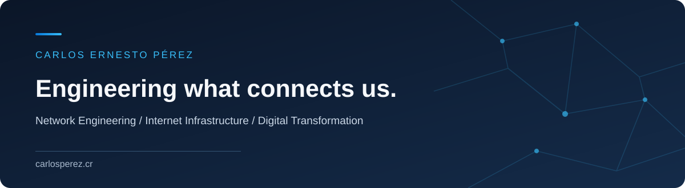

 

**Building resilient networks. Connecting engineering with strategy.**

[**Website**](https://carlosperez.cr) &nbsp;·&nbsp; [**Projects**](https://github.com/carlosperezcr?tab=repositories) &nbsp;·&nbsp; [**Contact**](https://carlosperez.cr/contact)

### Hello, I'm Carlos.

I work at the intersection of **Internet infrastructure, network engineering, automation, and digital transformation**. My experience spans telecommunications infrastructure, data centers, routing, interconnection, and the operational challenges of keeping critical networks reliable.

Based in **Costa Rica**, with experience across Latin America. I enjoy translating complex technical challenges into resilient systems and practical decisions with long-term impact.

### Areas of focus

**Internet infrastructure** · Internet exchange points, BGP, peering, RPKI, routing policy, IPv4 / IPv6  
**Network engineering** · High-capacity networks, data center connectivity, resilience, troubleshooting  
**Automation & observability** · Network tooling, monitoring, telemetry, operational workflows  
**Technology strategy** · Infrastructure evolution, technical leadership, digital transformation

### Selected work

| Project | What it explores |
| :--- | :--- |
| [**Personal website**](https://github.com/carlosperezcr/carlosperez-web) | Bilingual professional site, engineering writing, and ideas. [Visit carlosperez.cr](https://carlosperez.cr) |
| [**NetTools Pro**](https://github.com/carlosperezcr/nettools-pro) | Network tooling and practical engineering workflows |
| [**BGP monitoring · Zabbix & BIRD**](https://github.com/carlosperezcr/zabbix-bgp-monitoring-bird) | BGP monitoring and operational visibility |
| [**IPv4 / IPv6 BGP monitoring**](https://github.com/carlosperezcr/zabbix-bgp-ipv4-ipv6-monitoring) | Monitoring across both IP protocol families |

### Beyond the CLI

Great infrastructure is more than good configurations. It takes sound architecture, clear operational processes, and the ability to connect technical decisions with business priorities.

I also value sharing knowledge and helping others grow in networking and technology.

---

**Let's connect ideas, networks, and people.**

[**carlosperez.cr**](https://carlosperez.cr) &nbsp;·&nbsp; [**GitHub**](https://github.com/carlosperezcr)

Engineering discipline · Curiosity · Long-term perspective

